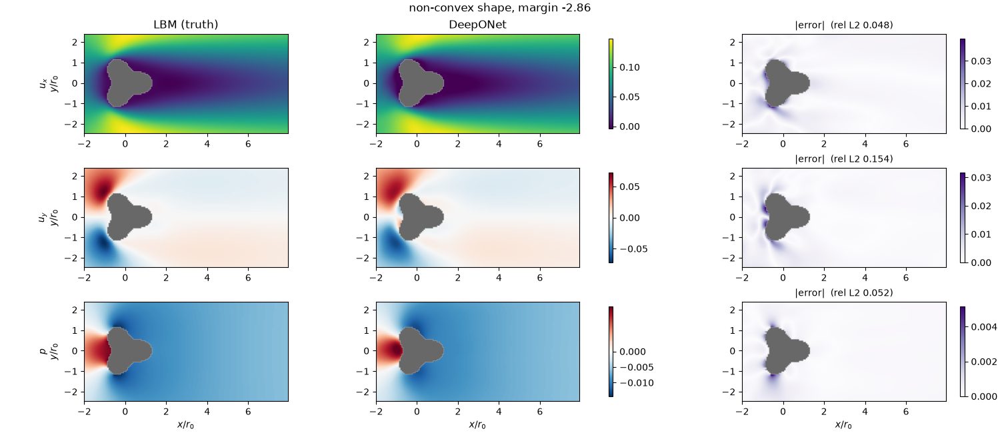

# Operator OOD Flow

**Status:** In progress. A DeepONet trained on 1200 convex shapes reaches 1–3% relative error in distribution. Out-of-distribution evaluation covers a non-convex trefoil, lobed shapes and regular polygons, and most of the OOD error is explained by distance to the nearest training shape. Multiple obstacles are still to do.

---

## Problem statement

Neural operator surrogates predict a simulation's output in milliseconds rather than minutes, which makes them useful in engineering design, where many shapes need to be evaluated quickly. But in design they are used on new shapes, unlike anything in their training data. There a surrogate can be wrong while its predictions still look physically plausible. To know when to trust it, we need to know which kinds of new geometry it handles, and why it fails on the rest.

This project asks:

> **When a DeepONet trained on flow around smooth convex obstacles meets unseen shapes, where and why does it fail?**

**Approach.** A lattice Boltzmann solver, written from scratch and validated against flow past a cylinder, generates steady 2D flow at Re = 20 around random smooth convex obstacles. A DeepONet learns to map each obstacle's signed distance field to the velocity and pressure fields. It is then tested on shapes that move step by step away from the training data along three axes: more concavity, sharp corners, and multiple obstacles.

---

## Key results so far

| Relative $L^2$ (test set, mean over shapes) | $u_x$ | $u_y$ | $p$ |
|---|---|---|---|
| All fluid cells | 0.011 | 0.034 | 0.013 |
| Wall band ($\|\text{sdf}\| < 0.3\,r_0$) | 0.071 | 0.091 | 0.040 |

- **In distribution**, error is small and concentrated in a thin layer at the body surface, and grows steadily as shapes become less convex. → [Results](docs/results.md)
- **Non-convex trefoil:** the overall flow is right, but the concave notches are smoothed over, giving 4–5× the test-set median error. → [Results](docs/results.md)
- **Lobed shapes:** even when fully convex, they are 1.3–1.4× worse than training-family shapes at the same convexity margin. Error grows with lobe amplitude; k=3 lobes are 1.5–2× easier than k=4 and k=5, which behave alike. → [OOD: lobed shapes](docs/ood-lobed.md)
- **Sharp corners:** error falls steadily with the number of polygon sides; triangles are 9–18× worse than the test set, octagons are close to it except for pressure. → [OOD: sharp corners](docs/ood-polygon.md)
- **Distance to the training set** predicts error across all sets: polygons with 4–8 sides fall on a line fitted to the convex and lobed shapes. Pressure is 1.5–1.6× worse than distance predicts on both OOD sets, and triangles' error levels off far below the extrapolated line. → [Error vs distance](docs/ood-distance.md)



---

## Documentation

| Page | Contents |
|---|---|
| [Background](docs/background.md) | Operator learning and the flow operator |
| [Data generation](docs/data.md) | Gaussian random functions, convex shape sampling, the LBM solver |
| [Model and training](docs/training.md) | DeepONet architecture, training setup, checkpoints |
| [In-distribution results](docs/results.md) | Test/validation errors, error vs convexity, trefoil, evaluation commands |
| [OOD: lobed shapes](docs/ood-lobed.md) | Family-shift offset and amplitude as the OOD axis |
| [OOD: sharp corners](docs/ood-polygon.md) | Regular polygons, error vs side count, where the corner error sits |
| [Error vs distance](docs/ood-distance.md) | Nearest-training-shape distance as a shared predictor of OOD error |

---

## Quickstart

Set up the Python 3.13 environment with `uv sync --locked`, then run from the project root:

```bash
uv run python -m scripts.generate_dataset                                    # -> data/train_convex.npz
EPOCHS=1000 WALL_FRAC=0.5 uv run python -m scripts.train                     # -> checkpoints/best.pt
uv run python -m scripts.generate_dataset --seed 1 --n-shapes 200 --out test_convex
uv run python -m scripts.evaluate checkpoints/best.pt test_convex            # -> data/test_convex_eval.csv
```

---

## Layout

| Path | Contents |
|---|---|
| `operator_ood_flow/` | Geometry, Gaussian random fields, LBM solver, DeepONet, and data preparation |
| `scripts/` | Dataset generation, training, evaluation, and plotting |
| `data/` | Generated datasets and evaluation CSVs |
| `checkpoints/` | Model weights and training history |
| `docs/` | Project documentation and figures |
