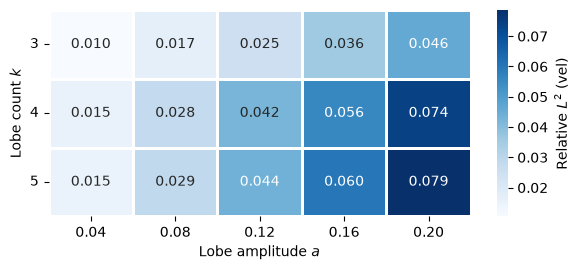
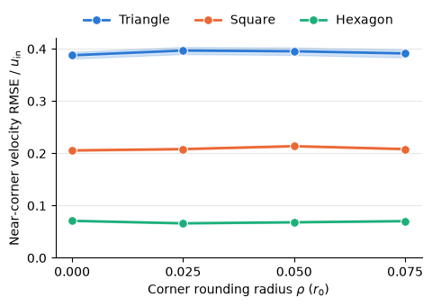
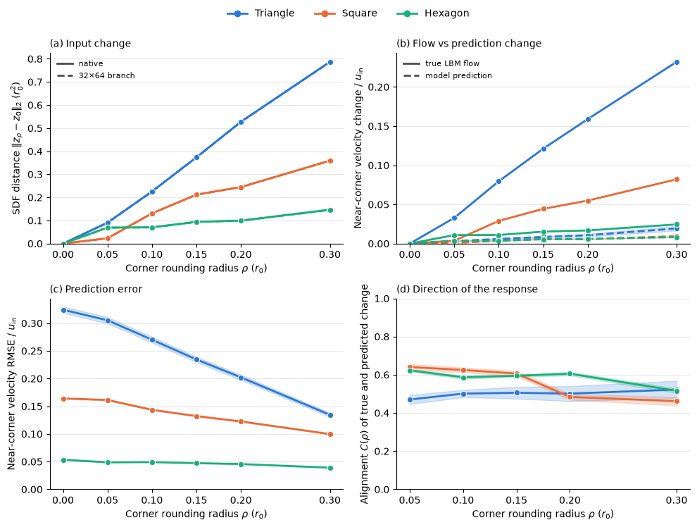
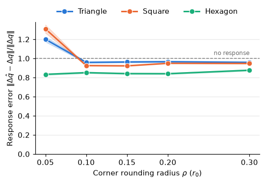

# Findings

[← Back to README](../README.md) · [Methodology](methodology.md) · [Theory](theory.md) · [Issues log](issues-log.md)

**Status:** preliminary (2026-11-07). All numbers are means over the 5 model seeds; the uncertainties are the std across seeds. Protocol and metric definitions are in [methodology](methodology.md). Figures are produced with `operator_ood_flow/plotting.py` from `notebooks/plots.ipynb`.

---

## 1. In distribution

`test_convex_s2_n200_seed1`, 200 shapes drawn like the training set:

| Relative $L^2$ | $u_x$ | $u_y$ | $p$ | velocity |
|---|---|---|---|---|
| All fluid cells | 0.010 ± 0.0003 | 0.036 ± 0.001 | 0.012 ± 0.0003 | 0.012 ± 0.0004 |
| Wall band ($\|\mathrm{sdf}\| < 0.3\,r_0$) | 0.084 ± 0.003 | 0.112 ± 0.004 | 0.036 ± 0.0005 | 0.093 ± 0.003 |

- **Small error, concentrated at the wall:** the wall-band velocity error is about 8× the all-fluid error.
- **Seeds agree closely:** mean errors differ by at most 0.01 between seeds. Since every seed uses the same training data and split, this std understates the full uncertainty (see [Limitations](#6-limitations)).

---

## 2. Lobed shapes: error grows with amplitude, not with non-convexity

`ood_lobedgrid_s2_n180`, velocity relative $L^2$ over all fluid cells:

| k \ a | 0.04 | 0.08 | 0.12 | 0.16 | 0.20 |
|---|---|---|---|---|---|
| 3 | 0.010 | 0.017 | 0.025 | 0.036 | 0.046 |
| 4 | 0.015 | 0.028 | 0.042 | 0.056 | 0.074 |
| 5 | 0.015 | 0.029 | 0.044 | 0.060 | 0.079 |

Convexity margin of the same shapes (training range: −0.197 to 0.84):

| k \ a | 0.04 | 0.08 | 0.12 | 0.16 | 0.20 |
|---|---|---|---|---|---|
| 3 | 0.63 | 0.22 | −0.23 | −0.71 | −1.25 |
| 4 | 0.33 | −0.39 | −1.18 | −2.04 | −2.99 |
| 5 | −0.04 | −1.17 | −2.41 | −3.76 | −5.25 |

- **Error grows steadily with lobe amplitude** for every k, rising 4.6–5.3× from a = 0.04 to 0.20. At the smallest amplitude it matches the in-distribution error (0.010–0.015 vs 0.012).
- **Convexity margin doesn't control the error.** k = 4 and k = 5 have nearly the same error at every amplitude, even though k = 5 is far less convex (margin −5.25 vs −2.99 at a = 0.2). k = 3 is easier than both.
- **The wall band amplifies the trend:** at a = 0.2, `vel_wall` reaches 0.27 (k = 3) and 0.43–0.44 (k = 4, 5).

---

## 3. Polygons: side count sets the error, and rounding lowers it

`ood_polygrid_s2_n180`, near-corner velocity RMSE / $u_\mathrm{in}$ (std across seeds ≤ 0.006):

| | ρ = 0 | 0.05 | 0.1 | 0.15 | 0.2 | 0.3 |
|---|---|---|---|---|---|---|
| Triangle | 0.324 | 0.305 | 0.270 | 0.235 | 0.202 | 0.135 |
| Square | 0.164 | 0.161 | 0.144 | 0.132 | 0.123 | 0.100 |
| Hexagon | 0.053 | 0.049 | 0.049 | 0.047 | 0.046 | 0.039 |

- **Side count is the main factor.** For sharp polygons, velocity relative $L^2$ over all fluid cells is 0.220 for triangles, 0.089 for squares and 0.024 for hexagons. That is 18×, 7× and 2× the in-distribution error.
- **Rounding lowers near-corner error** by 58% for triangles, 39% for squares and 26% for hexagons between ρ = 0 and 0.3. Rounding by 0.3 $r_0$ is worth about one extra side: a rounded triangle (0.135) beats a sharp square (0.164).
- **The two polygon grids are consistent:** the ρ = 0 values match `ood_polygrid_s2_n120`, which contains the same sharp shapes.

Section 4 shows that this fall in error does **not** mean the model handles rounded corners better.

---

## 4. Rounding sensitivity: the model barely responds to the geometry change

For each rounded polygon compared with its sharp counterpart (triangles at ρ = 0.3 quoted below; all shapes in the figure):

| Change from the sharp shape | Triangle, ρ = 0.3 |
|---|---|
| (a) SDF input at native resolution | 0.787 $r_0^2$ |
| (a) SDF input at 32 × 64 branch resolution | 0.786 $r_0^2$ |
| (b) true near-corner flow, $\|\Delta q\|$ | 0.232 $u_\mathrm{in}$ |
| (b) predicted near-corner flow, $\|\Delta\hat q\|$ | 0.019 $u_\mathrm{in}$ |
| (d) alignment $C$ | 0.52 |

- **(a) The input resolution isn't the bottleneck, by this measure.** The 32 × 64 branch input keeps the SDF change: native and branch agree to within 1% for every side count and ρ.
- **(b) The model's response is about 12× too small.** It receives a clearly different input, but its near-corner prediction barely changes.
- **(c) So the falling error in §3 comes from the true flow moving toward the model's nearly fixed prediction,** not from the model tracking the rounding.
- **(d) The direction of the response is roughly right.** $C$ = 0.46–0.64 for every side count and ρ (std ≤ 0.05), well above the ≈ 0 expected for unrelated changes. Individual shapes range from −0.39 to 0.83.

### Response error

The relative response error $E = \|\Delta\hat q - \Delta q\| / \|\Delta q\| = \sqrt{1 + R^2 - 2RC}$, with $R = \|\Delta\hat q\| / \|\Delta q\|$ ([theory §6](theory.md#6-response-error-identity)), combines size and direction. $E = 1$ is what predicting no change at all would score. The identity holds per shape to within $3\times10^{-7}$.

| | ρ = 0.05 | 0.1 | 0.15 | 0.2 | 0.3 |
|---|---|---|---|---|---|
| Triangle | 1.20 | 0.96 | 0.96 | 0.97 | 0.96 |
| Square | 1.31 | 0.93 | 0.92 | 0.95 | 0.95 |
| Hexagon | 0.83 | 0.85 | 0.84 | 0.84 | 0.88 |

- **From ρ = 0.1 upward, E stays at 0.92–0.97 for triangles and squares.** The predicted change is only 3–8% closer to the true change than no change at all would be. Hexagons, the shapes closest to the training family, do best, at about 0.85.
- **Ignore ρ = 0.05:** the true change there is tiny (0.004 $u_\mathrm{in}$ for squares), so E is dominated by noise. Individual shapes reach 3.9.
- **Averaging:** values are means of per-shape E, which isn't the same as plugging the mean R and C into the identity.

---

## 5. Interpretation

Across both OOD families, the model behaves like a **damped map from geometry to flow**. Its output changes in roughly the right direction when the geometry changes, but by only a small fraction of the true change. Near-corner error therefore follows how far the *true* flow is from a smooth, convex-like prediction:
- it grows with lobe amplitude and with corner sharpness;
- it falls when rounding makes the true flow smoother;
- it is set mainly by side count.

This fits the spectral-bias hypothesis, but it isn't a test of it. The NTK and harmonic-injection experiments are still to do.

---

## 6. Limitations

- **The global SDF distance may hide local loss of detail.** Keeping the area fixed moves the whole boundary, so $\|z_\rho - z_0\|$ is dominated by smooth, far-reaching changes. A comparison restricted to the corner region would be a stricter test of whether corner detail survives downsampling ([issues log #12](issues-log.md)).
- **Side count changes several things at once:** corner angle, number of corners and overall shape, so the polygon grid can't separate them.
- **The corner region is a design choice:** radius $0.5\,r_0$ around the sharp vertex. Other radii haven't been tested.
- **The reference flow is itself discretised.** At s = 2, ρ = 0.05 is one lattice cell and boundaries are staircased with bounce-back. Polygons converge slowest in the grid study: against s = 3, the worst polygon's wall-band $u_x$ error is about 0.19 ([issues log #5](issues-log.md)). Small-ρ effects are partly discretisation effects.
- **Seed std understates uncertainty:** the seeds share the training data and split, so it reflects initialisation and sampling noise only, not variation in the data.
- **Narrow physics:** steady 2D flow at a single Re = 20, a single body size, and inlet Mach 0.17.

Earlier results that have since been superseded, and the fixes behind them, are recorded in the [issues log](issues-log.md), in particular #11 (corner region) and #12 (rounding range).
