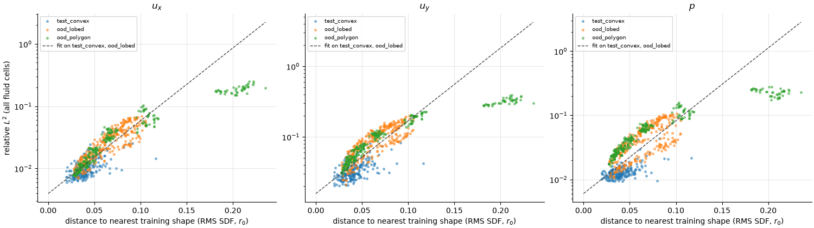

# Error vs distance to the training set

[← Back to README](../README.md)

The OOD sets so far have each been described by their own parameter: lobe amplitude, number of polygon sides. This page asks whether one shared measure, how far a shape is from anything the model was trained on, predicts the error across all of them.

**Distance.** For each shape, the distance is taken to its nearest neighbour among the 1000 training shapes, using the downsampled SDF that the branch net actually sees ($32 \times 64$, in units of $r_0$). It is reported as the RMS difference per SDF cell, so a distance of 0.1 means the SDFs differ by about $0.1\,r_0$ on average.

**Fit.** $\log(\text{error})$ is fitted as a straight line in distance, using the convex test set and the lobed set only. The polygons are kept out of the fit and checked against it.



| Set | Median distance | Spearman $\rho$ ($u_x$, $u_y$, $p$) | Error vs fit ($u_x$, $u_y$, $p$) |
|---|---|---|---|
| Convex test | 0.040 | 0.59, 0.56, 0.47 | 0.84, 0.79, 0.73 |
| Lobed | 0.063 | 0.88, 0.83, 0.73 | 1.17, 1.27, 1.48 |
| Polygon | 0.052 | 0.98, 0.98, 0.97 | 1.04, 1.19, 1.63 |

"Error vs fit" is the median ratio of actual to fitted error: above 1 means the set does worse than its distance predicts.

**Distance explains most of the OOD error.** Within every set, error rises with distance. Polygons with 4–8 sides, which were not used in the fit, fall on the same line as the lobed shapes for $u_x$ and close to it for $u_y$. So much of what looked like a separate "sharp corner" effect is just that blunter polygons are closer to the training shapes: median distance falls from 0.21 for triangles to 0.03 for octagons, in the same order as the error.

**But not all of it.** Two things don't fit:

- **Pressure is worse than distance predicts** for both OOD sets, by 1.5× for lobed shapes and 1.6× for polygons. Pressure is set mostly at the surface, so it may depend on boundary details that an RMS over the whole SDF averages away.
- **Triangles saturate.** They sit far beyond every other shape (distance 0.18–0.24) but their error is 4–6× below what the fit extrapolates to. The error levels off rather than growing exponentially with distance; the [triangle fields](ood-polygon.md#where-the-error-is) still show a roughly correct wake, just with the corner flow smeared. The log-linear fit only describes the range 0–0.12.

The convex test set sits slightly below the line (0.7–0.8×) and has the weakest correlation, since in distribution all shapes are close and the remaining error is mostly noise around the convexity trend in [Results](results.md).

## Reproducing

Needs the evaluate CSVs from [Results](results.md), [OOD: lobed shapes](ood-lobed.md) and [OOD: sharp corners](ood-polygon.md):

```bash
uv run python scripts/plot_distance.py checkpoints/best.pt \
    data/test_convex_eval.csv data/ood_lobed_eval.csv data/ood_polygon_eval.csv   # -> docs/figures/error_vs_distance.png
```

The training shapes and SDF resolution are read from the checkpoint. `--fit` chooses which sets the line is fitted on (default `test_convex ood_lobed`), and the table above is printed to the terminal.
