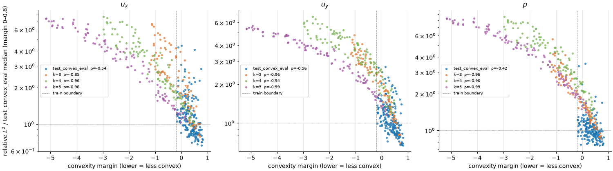
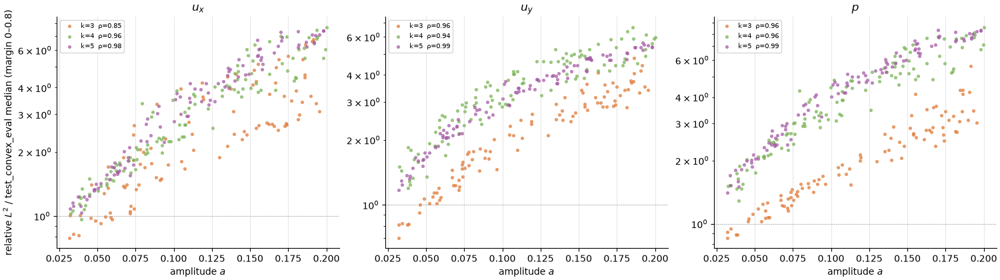

# OOD generalisation: lobed shapes

[← Back to README](../README.md)

300 lobed shapes were generated with $r(\theta) = r_0(1 + a\cos k(\theta - \phi))$, $k \in \{3,4,5\}$, $a \in [0.03, 0.2]$. These are single-frequency perturbations of a circle that are convex at low amplitude but become concave once $a$ is large enough for a given $k$.

To isolate family shift from concavity, errors are compared in the overlap window $0 \le \text{margin} \le 0.8$, where both the convex test set and the lobed set have fully convex shapes. The errors are normalised by the convex test-set median in that window.



**Family-shift offset.** In the overlap window the lobed shapes are 1.3–1.4× worse than convex shapes at the same convexity margin (bootstrap 95% CI excludes 1.0 for all three fields). This offset is consistent across margin bins of width 0.2, so it is not an artefact of the two sets sitting at different margins. $p$ shows the largest offset (~1.4×), consistent with the [trefoil result](results.md).

The offset is present even at $\text{margin} \approx 0.8$ (near-circular), which suggests the model is sensitive to the *type* of shape variation, not just convexity.



**Amplitude orders the error within each k; frequency matters only from k=3 to k=4.** Against amplitude $a$, error rises steadily for every k (Spearman $\rho$ 0.85–0.99). The k=4 and k=5 series overlap, but k=3 sits clearly below them, by about 1.5–2× for $u_y$ and $p$ at the same $a$. So frequency is not irrelevant: going from k=3 to k=4 raises the error, while going from k=4 to k=5 does not.

Because k=5 is no worse than k=4, a resolution bottleneck is unlikely to be the main cause; if the model could not resolve fine boundary detail, error would keep rising with k. One possible explanation, not yet tested, is that the training shapes are built from the $\cos\theta$ and $\cos 2\theta$ modes plus a smooth random perturbation, so mode 3 is closer to the training distribution than modes 4 and 5.

## Reproducing

```bash
uv run python scripts/generate_dataset.py --sampler lobed --amp 0.03 0.2 \
    --n-shapes 300 --seed 2 --out ood_lobed
uv run python scripts/evaluate.py checkpoints/best.pt ood_lobed
uv run python scripts/plot_convexity.py data/test_convex_eval.csv data/ood_lobed_eval.csv \
    --out docs/figures/ood_concavity.png
uv run python scripts/plot_convexity.py data/test_convex_eval.csv data/ood_lobed_eval.csv \
    --x amp --out docs/figures/ood_amplitude.png
```

Next: [OOD generalisation: sharp corners](ood-polygon.md)
