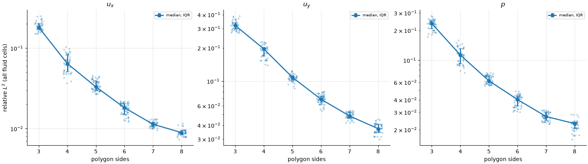
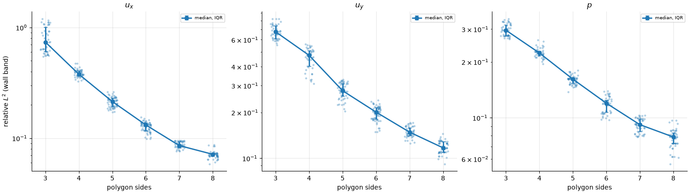
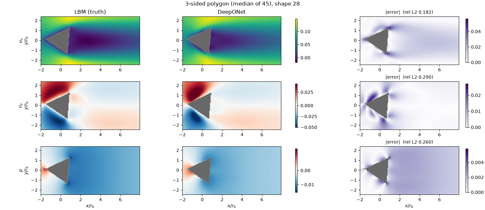
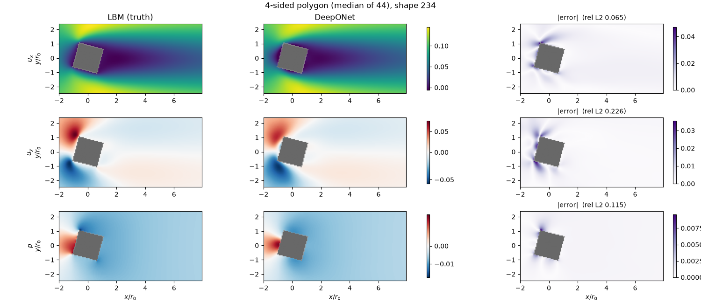
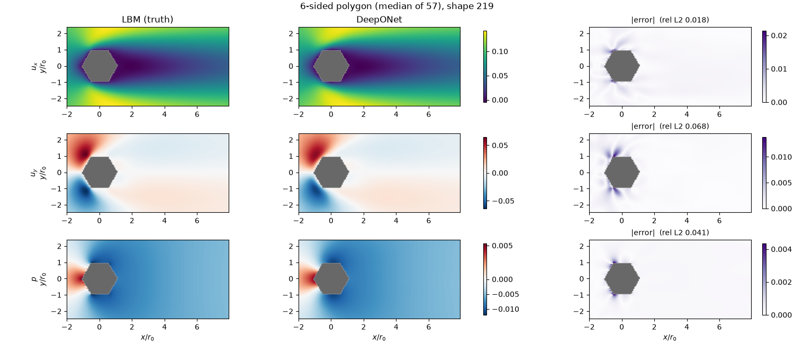

# OOD generalisation: sharp corners

[← Back to README](../README.md)

300 regular polygons were generated with $n \in \{3, \dots, 8\}$ sides (44–57 shapes per $n$) and a random rotation. Each polygon has the same area as a circle of radius $r_0$, so size does not change with $n$. All of them are convex, so the convexity margin cannot explain any differences between them; what changes with $n$ is how sharp the corners are, from 60° interior angles at $n=3$ to 135° at $n=8$.



**Error falls steadily as corners get blunter.** Error drops with every extra side (Spearman $\rho$ between −0.98 and −0.99 for all three fields), and the spread within each $n$ is small. Median relative $L^2$ over all fluid cells:

| Sides | $u_x$ | $u_y$ | $p$ |
|---|---|---|---|
| 3 | 0.182 | 0.320 | 0.235 |
| 4 | 0.064 | 0.196 | 0.113 |
| 5 | 0.033 | 0.108 | 0.062 |
| 6 | 0.018 | 0.069 | 0.040 |
| 7 | 0.011 | 0.048 | 0.027 |
| 8 | 0.009 | 0.037 | 0.023 |

Octagons are already close to the convex test set (means 0.011, 0.034, 0.013), apart from $p$, which stays about 1.8× higher. Triangles are 9–18× worse than the test set, and 3–4× worse than the non-convex trefoil.



In the wall band the same trend holds, and the triangle $u_x$ error reaches 0.74, not far from the 1.0 that predicting zero everywhere would give.

## Where the error is

The median-error shape for $n = 3$, 4 and 6 (chosen by $u_x$ error):



On the triangle the model gets the overall wake roughly right, but the error is concentrated at the corners, where the flow separates sharply. The predicted $u_y$ lobes ahead of the body are misplaced, and the low-pressure spots at the rear corners are smeared out. Unlike the smooth shapes, a noticeable error also spreads downstream through the wake, mostly in $u_x$ and $p$.





By $n = 6$ what error remains sits in small spots at the corners, much like the thin wall layer on the convex test set.

How far each polygon is from the training shapes, and whether that explains these errors, is covered in [Error vs distance to the training set](ood-distance.md).

## Reproducing

```bash
uv run python scripts/generate_dataset.py --sampler polygon --n-shapes 300 --seed 3 --out ood_polygon
uv run python scripts/evaluate.py checkpoints/best.pt ood_polygon                     # -> data/ood_polygon_eval.csv
uv run python scripts/plot_polygon.py --ref data/test_convex_eval.csv                 # -> docs/figures/ood_polygon.png
uv run python scripts/plot_polygon.py --ref data/test_convex_eval.csv --wall          # -> docs/figures/ood_polygon_wall.png
uv run python scripts/plot_polygon_fields.py checkpoints/best.pt                      # -> docs/figures/ood_polygon_fields_n{3,4,6}.png
```

`plot_polygon.py` also prints the mean and median per side count and the Spearman correlations.

Next: [Error vs distance to the training set](ood-distance.md)
